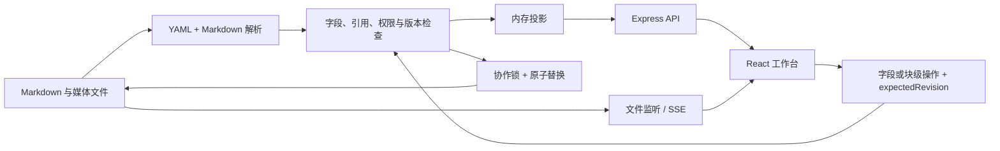

# Markdown 与前端交互协议

通用工作台扩展见 [模板继承、业务引用与升级协议](workbench.md)。其中模板专用维护接口替代下文旧版系统文档仅由源码维护的限制；普通业务 PATCH 仍不能任意改系统定义。其余事实、确认及并发约定继续适用。

## 维护源与目录

`.md` 是业务文本、字段、关联关系、页面模板、块定义、界面文案和来源策略的唯一维护源。YAML frontmatter 保存有类型的结构数据，正文保存 Markdown 内容块；图片、视频和其他文件通过相对媒体 key 引用。

浏览器和 API 可生成 JSON、HTML、AST 或内存索引，但这些产物不能成为另一份手工维护的数据。JSON Listing 导出是一次性快照。当前文件布局保持浅层：`ui/`、`schemas/`、`templates/`、`views/`、`entities/` 和 `media/`。

```yaml
---
format: outrise/1
id: sku_example
kind: sku
name: Example / Olive
parent: spu_example
schema: schema_product
template: template_sku
policy: local-edit
fields:
  sku_code: EXAMPLE-OLV
  color: Olive
  weight:
    value: 0.74
    unit: kg
---
```

`id` 是稳定身份，名称可以修改。引用用 ID，文件移动不改变业务身份。`name` 是记录名称，不重复放入 `fields`。

## 实体、关系与继承

产品层级固定为 `brand → product_line → spu → sku`。品牌与产品线使用基础说明字段。SPU 与 SKU 共用 `schema_product`，SKU 只保存本身属性和显式覆盖。

- SKU 缺少某个共享字段时，实时读取父 SPU 的值。
- 保存相同值也视为显式覆盖；不会因为值相同而自动恢复继承。
- 恢复继承删除 SKU 对应字段，不把父值复制进去。
- `null` 是显式值，只在 `nullable: true` 时允许，不代表恢复继承。
- `scope: sku` 只能用于 SKU；`scope: spu` 表示 SPU 自身字段。共享型号使用 `scope: shared`。
- `overridable: false` 的 SPU 属性不能被 SKU 改写。演示中品牌、型号、材质不可覆盖；重量和容量可覆盖。
- 不对品牌→产品线→SPU 进行任意字段自动合并；这几层的关联用于目录和策略、素材适用范围。

字段描述包含 `type`、`label_key`、`required`、`scope`、`overridable`、`nullable`，可附 `options`。Listing 字段可附 `platforms`，声明适用平台，使新建空草稿也能显示对应表单。保存始终校验类型；必填内容在人工确认时检查，草稿可以不完整。

策略与素材通过 `scopes: [id, ...]` 关联品牌、产品线、SPU 或 SKU。页面可沿目录展示适用记录，Listing 使用显式选择的策略和素材，避免把所有相关内容自动合并成最终决策。

## 模板与内容块

采用 `remark-directive` 风格的声明式语法。禁止在数据文件中执行 JSX、JavaScript、MDX 或任意组件代码。

模板定义固定模块和可编辑区域：

```markdown
::fields{#facts}

::region{#notes}
```

模板 frontmatter 声明区域规则：

```yaml
regions:
  notes:
    label_key: blocks.notes
    allowed_types: [richtext, gallery]
    can_add: true
    can_delete: true
    can_move: true
```

实体仅保存自己的内容块，不复制模板中的固定模块：

```markdown
:::richtext{#usage region="notes" policy="local-edit" title="使用说明"}
## 工作日携带

这里是可编辑的普通 Markdown。
:::
```

- 块 ID 在同一文件内唯一且稳定。V1 业务块只允许顶层，不能相互嵌套。
- 固定模块可以提供字段表单或特定操作，但用户不能在实体页面删除、移动或改写它的类型。
- `richtext` 的正文交给 Milkdown 编辑；外围 ID、区域和策略由文档层保留。
- 内置块包含 `fields`、`richtext`、`gallery`、`listing`、`notice`、`region`，保留 `asset`、`relations` 的扩展位置。
- 模板实时应用于引用它的实体，不执行复制或破坏性迁移。
- 删除区域、减少容量、改变允许类型，或遇到未知块时，实体内容进入“暂未放置”区域并保留原文；不静默丢弃。

## 来源策略与编辑交集

文档 `policy` 与块属性 `policy` 引用 `kind: policy` 的 Markdown 文档。策略声明 `actors.human` 和 `actors.agent` 对 `fields`、`metadata`、`blocks`、`confirm` 的能力。

实际操作须同时满足来源文档、来源块和模板区域限制。模板可以收紧显示与操作，不能放宽来源只读策略。服务端执行同样检查，隐藏按钮不是唯一保护。

`local-edit` 和演示别名 `policy_default` 允许人工编辑及确认，允许 Agent 维护字段、关联、内容和提交建议，但禁止 Agent 确认。`readonly` 示例禁止双方编辑。系统文档（schema、template、policy、ui、view、config）由源码维护，不通过普通业务编辑 API 修改。

这些是可信本机用户与合作 Agent 的工作约定；不替代上线后的认证授权。

## Listing、输入依据与确认

每份 Listing 记录 `platform`、`target`、`spu`、`skus`、`strategies`、有序 `assets`、共享 `fields`、`variant_fields`，以及正文描述块。一个平台目标下，同一 SPU 保持一份活动草稿；所选 SKU 必须属于该 SPU。

| 平台 | 本地内容字段 |
| --- | --- |
| Amazon | 标题、卖点列表、搜索词、正文描述、媒体与 SKU 内容覆盖 |
| Shopify | 标题、vendor、商品类型、标签、SEO 标题/描述、正文描述、媒体与 SKU 内容覆盖 |
| TikTok Shop | 标题、品牌、类目意向、正文描述、媒体与 SKU 内容覆盖 |

类目意向不是官方类目 ID。上述模板便于内容准备，不包含各平台当前完整必填规则，不把未知账号、变体主题、价格或库存自动补成有效发布值。

`inputs` 由服务端记录 SPU、SKU、显式策略和素材的业务内容 hash、源文件 revision、可用的确认快照，以及实际媒体文件 hash。内容生成或重新确认前检查这些依据。模板布局变化不应让 Listing 失效；事实、策略、所选范围或实际媒体变化应要求复核。

产品事实默认“待确认”；策略、素材及 Listing 默认“草稿”。人工确认创建不可变 Markdown 快照，记录业务 hash。之后修改业务内容会恢复待确认或草稿状态，并保留上次确认记录。手工在文件里填 `review.state: confirmed` 不能产生有效确认。

Listing 确认需要当前输入依据一致，所用事实与策略已经人工确认。确认不等于官方平台发布许可。生成依据未记录时显示需要复核，不伪造历史。

## 运行时数据流与安全写入



写入基于整个源文件 SHA-256 revision，使用协作锁，写同目录临时文件后原子替换。冲突返回 409，客户端不得覆盖新版本。对象路径限制在工作区内，拒绝路径穿越和符号链接；媒体 API 只提供已登记素材。

正文编辑按源码位置替换目标块；YAML 使用保留节点信息的解析器更新。未涉及块、未知属性和可保留注释不得在普通编辑中静默丢失。解析失败时不自动修复或覆盖原文件；显示诊断并保留可用的上一版内存投影。

外部文件变化通过监听和 SSE 更新。页面有未保存修改时提示冲突，不能以远端变化静默替换人工草稿。直接操作系统写文件会绕开应用协作锁，Agent 应优先使用 CLI。
